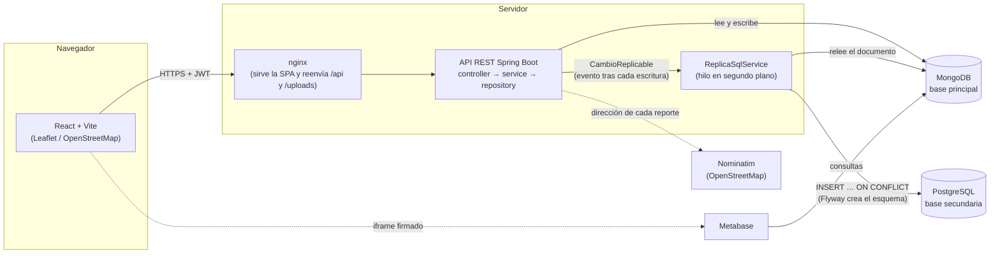
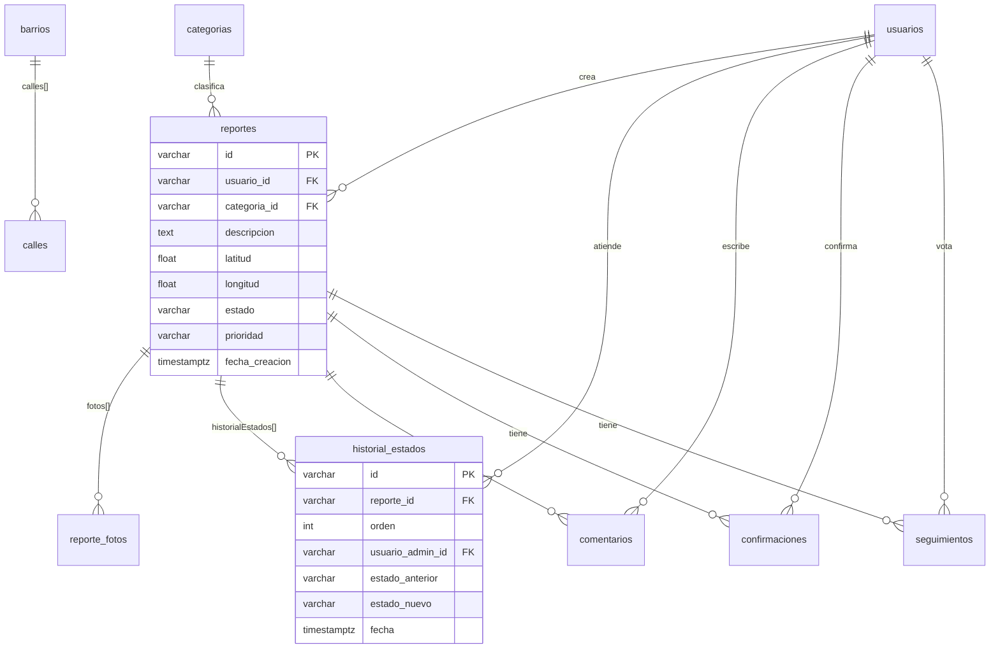

# ViaCTG — Reporte ciudadano de daños viales en Cartagena

ViaCTG es una plataforma web para que la ciudadanía de Cartagena reporte daños en las vías (huecos, inundaciones,
hundimientos, alcantarillas…) y siga su atención. Los ciudadanos crean reportes con ubicación en el mapa y fotos,
confirman los de otros, comentan y responden «¿ya lo arreglaron?»; los moderadores y administradores revisan, priorizan y
cambian el estado de cada caso, con historial, notificaciones, estadísticas y auditoría.

| Capa | Tecnología |
| --- | --- |
| Frontend ([FrontEnd/](FrontEnd)) | React 19, TypeScript, Vite, React Router, Axios, Leaflet + OpenStreetMap, Tailwind |
| Backend ([ViasCTG/](ViasCTG)) | Java 21, Spring Boot 3.3, Spring Security + JWT, Spring Data MongoDB, JDBC + Flyway |
| Base principal | **MongoDB 7** (`viasctg_db`) |
| Base secundaria | **PostgreSQL 17** (`viasctg_sql`): réplica relacional para SQL y analítica |
| Analítica | Metabase embebido en el panel; guía equivalente en Power BI |
| Infraestructura | Docker Compose, GitHub Actions (CI) |

## Qué puede hacer cada rol

| Rol | Funciones |
| --- | --- |
| Visitante | Ver reportes (listado paginado con búsqueda y filtros, mapa, detalle), cifras de la portada, registrarse |
| Ciudadano | Crear reportes (punto en el mapa dentro de Cartagena, categoría del catálogo, descripción, hasta 3 fotos), ver si ya lo reportaron (a menos de 100 m), editar los suyos mientras están pendientes, confirmar, comentar, votar «¿ya lo arreglaron?», notificaciones, perfil |
| Moderador | Panel: cola de reportes ordenable, cambio de estado individual o en lote con comentario y prioridad, historial, señales de la comunidad, estadísticas, dashboard |
| Administrador | Todo lo anterior más usuarios (rol y activación), barrios y calles, categorías, auditoría y la réplica SQL |

Flujo de un reporte: `PENDIENTE → EN_REVISION → EN_PROCESO → RESUELTO`, y `RECHAZADO` desde cualquier estado activo.

## Arquitectura



- El backend sigue capas fijas bajo `com.viactg`: `controller` (solo DTOs), `service` (reglas de negocio, permisos y
  validación de referencias), `repository`, `model`, `dto`/`mapper`, `security` (filtro JWT), `exception` (errores en
  español con el mismo formato) y `config`.
- Toda escritura sobre un documento existente es una actualización parcial atómica (`findAndModify` con `$set`, `$push`,
  `$inc`) filtrando por el estado leído: dos moderadores a la vez no se pisan (el segundo recibe `409`).
- Seguridad: BCrypt, JWT con versión revocable, roles leídos de la base en cada petición, permisos por URL y con
  `@PreAuthorize`, límites de intentos (login, registro, reportes, comentarios) y verificación de correo.

## Bases de datos

### MongoDB (principal)

La aplicación lee y escribe solo aquí. Lo que se consulta junto va **embebido**; lo que tiene vida propia es una
colección aparte y se **referencia** por id:

| Colección | Embebido | Referencia a | Índices destacados |
| --- | --- | --- | --- |
| `reportes` | `historialEstados[]`, `fotos[]`, `ubicacion` (GeoJSON), `categoria {id, nombre}` | `usuarios` (`usuarioId`), `categorias` (`categoria.id`) | `2dsphere`, `(estado, fechaCreacion)`, `(categoria.id, fechaCreacion)` |
| `barrios` | `calles[]` | — | `nombreClave` único |
| `usuarios` | — | — | `email` único |
| `categorias` | — | — | — |
| `comentarios`, `confirmaciones`, `seguimientos` | — | `reportes`, `usuarios` | únicos `(reporteId, usuarioId)` en confirmaciones y votos |
| `notificaciones`, `auditoria` | — | `usuarios` | por usuario y fecha |
| `tokens_recuperacion`, `tokens_verificacion` | — | `usuarios` | TTL (Mongo los borra al vencer) |

La categoría del reporte es una **referencia extendida**: guarda el `id` del catálogo y una copia del `nombre`, así se
muestra, filtra y agrupa sin consultar `categorias`; si un administrador la renombra, la copia se actualiza en todos
sus reportes. Con los datos de demostración, que vienen activados, la base tiene más de **23 000 documentos**.

### PostgreSQL (secundaria)

Una réplica relacional y normalizada que nunca lee la aplicación: sirve para consultas SQL, reportes y analítica. Si
PostgreSQL se cae, todo sigue funcionando y la réplica se reintenta sola. Lo embebido en Mongo pasa a tablas hijas:



Cada escritura en Mongo publica un evento (`CambioReplicable`); un hilo en segundo plano relee ese documento y lo copia
con `INSERT … ON CONFLICT DO UPDATE`. Al arrancar (y desde la pestaña **Base SQL** del panel) la réplica se reconstruye
completa. El esquema está versionado con Flyway (`ViasCTG/src/main/resources/db/migration`) e incluye las vistas
`v_reportes_por_categoria`, `v_reportes_detalle` y `v_actividad_moderadores`. No se copian contraseñas ni tokens.
Detalle en [ViasCTG/README.md](ViasCTG/README.md#base-secundaria-en-postgresql).

## Estructura del repositorio

```text
ViasCTG/             API Spring Boot (código, pruebas, colección de Postman, scripts SQL locales)
FrontEnd/            Cliente React (pantallas públicas y panel de administración)
docs/                Guías de Metabase, Power BI (con datos de ejemplo), despliegue en Azure e inicio de sesión con Google
docker-compose.yml   Mongo, PostgreSQL, backend, frontend, Metabase y túnel opcional para la demo
configurar-metabase.py, exportar-powerbi.py, demo-tunel.sh   Utilidades del dashboard y la demo pública
```

## Cómo ejecutarlo

### Opción A: en el PC, sin Docker

Requisitos: JDK 21, Node.js 20 o superior, MongoDB en `localhost:27017` y, para la base secundaria, PostgreSQL en
`localhost:5432`.

1. Configuración local: copia `ViasCTG/local.properties.example` como `ViasCTG/local.properties` (no se sube a git) y
   completa el secreto JWT, el administrador local y la contraseña del usuario `viasctg` de PostgreSQL.
2. Base secundaria (una vez): crea el usuario y la base en PostgreSQL; pide la contraseña del usuario `postgres`.

   ```powershell
   cd ViasCTG
   powershell -ExecutionPolicy Bypass -File sql\crear-base-local.ps1
   ```

3. Backend. El primer arranque crea los datos de demostración (más de 23 000 documentos, ver más abajo):

   ```powershell
   cd ViasCTG
   .\mvnw spring-boot:run
   ```

4. Frontend, en otra terminal:

   ```powershell
   cd FrontEnd
   npm install
   npm run dev
   ```

Abre `http://localhost:5173` y entra al panel con el administrador de `local.properties`. Swagger queda en
`http://localhost:8080/swagger-ui/index.html`.

### Opción B: con Docker Compose

```bash
cp .env.example .env            # define JWT_SECRET y SQL_PASSWORD (openssl rand -base64 32)
docker compose up -d --build    # Mongo, PostgreSQL, backend, frontend (http://localhost:5173) y Metabase (:3000) con el dashboard ya armado
```

En los dos casos, el primer arranque llena las bases con los datos de demostración.

### Opción C: en un servidor con HTTPS (por ejemplo, Azure)

Con `DOMINIO` y `FRONTEND_URL=https://<DOMINIO>` en el `.env`, `docker compose --profile https up -d --build` agrega
Caddy delante del sitio, con certificado de Let's Encrypt automático, y el dashboard queda en la misma dirección.
Paso a paso en una VM de Azure: [docs/azure.md](docs/azure.md).

## Datos de demostración

**Vienen activados** (`SEED_DEMO=true`, `SEED_DEMO_REPORTES=10000`) para que el proyecto se pueda evaluar con datos
apenas se ejecuta. Solo actúan si la base tiene menos de 20 reportes: nunca duplican datos ni tocan una base que ya
tenga información. En un despliegue real, pon `SEED_DEMO=false`.

Al arrancar, el backend crea `SEED_DEMO_REPORTES` reportes de los últimos 12 meses en nueve barrios reales (25 %
pendientes, 15 % en revisión, 20 % en proceso, 30 % resueltos y 10 % rechazados), con historiales de transiciones válidas y fechas crecientes, y en proporción:

- un ciudadano demo por cada 40 reportes (mínimo 5; `ciudadanoN@demo.viasctg.local`) y 3 moderadores demo
  (`moderadorN@demo.viasctg.local`), con el correo verificado y una contraseña aleatoria que nadie conoce;
- comentarios (~0,45 por reporte), confirmaciones (~0,46, nunca del autor ni repetidas) y votos «¿ya lo arreglaron?»
  (solo en reportes activos), con fechas dentro del tiempo en que el caso estuvo abierto.

Con los 10 000 reportes por defecto la base queda con **más de 23 000 documentos** (10 000 reportes, 253 usuarios y unos
4 500 comentarios, 4 600 confirmaciones y 4 000 votos); tarda unos 2 segundos. Se insertan por bloques de 1 000, sin
geocodificar ni enviar notificaciones ni correos, y al final la réplica SQL se reconstruye una vez. La semilla es fija:
siempre salen los mismos datos.

```bash
# Ver cuántos se crearon
docker compose logs backend | grep SEED_DEMO

# Borrarlos: los reportes empiezan con "[DEMO]" y las cuentas usan @demo.viasctg.local
docker compose exec mongo mongosh viasctg_db --eval '
  const ids = db.reportes.find({descripcion: /^\[DEMO\]/}, {_id: 1}).toArray().map(r => r._id.toString());
  ["comentarios", "confirmaciones", "seguimientos", "notificaciones"].forEach(c => db[c].deleteMany({reporteId: {$in: ids}}));
  db.reportes.deleteMany({descripcion: /^\[DEMO\]/});
  db.usuarios.deleteMany({email: /@demo\.viasctg\.local$/})'
```

Después de borrarlos, pulsa «Reconstruir réplica» en la pestaña Base SQL del panel (o reinicia el backend) y deja
`SEED_DEMO=false` en el `.env`: si no, se vuelven a crear en el siguiente arranque mientras haya menos de 20 reportes.

## Iniciar sesión con Google

Con `GOOGLE_CLIENT_ID` en el `.env`, el login y el registro muestran **Continuar con Google**. El backend verifica el ID
token de Google (firma, emisor, Client ID y vigencia) y abre la misma sesión que el login con contraseña. Una cuenta con
ese correo se vincula y, si no existe, se crea como ciudadano con el correo ya confirmado. Sin la variable, el botón no
aparece. Para crear el Client ID y ver las reglas de vinculación: [docs/google.md](docs/google.md).

## Dashboard (Metabase)

El panel tiene una pestaña **Dashboard** (moderador y admin) con un dashboard de [Metabase](https://www.metabase.com/)
open source conectado a `viasctg_db`, mostrado en un iframe con **embebido estático firmado**: `GET /api/admin/dashboard`
devuelve `{url, expiraEn}`, una URL con un JWT HS256 firmado con la clave de embebido de Metabase, que nunca sale del
backend. El panel pide otra URL antes de que venza y el dashboard se actualiza cada minuto. Sin configuración, la API
responde `503` «El dashboard no está configurado». El botón **Descargar estadísticas (.csv)** baja las cifras de la
pestaña Estadísticas.

**Con docker compose se configura solo**: el servicio `metabase-setup` crea la cuenta de administrador de Metabase,
conecta la base, oculta las colecciones sensibles, crea las ocho preguntas, publica el dashboard y le pasa la clave y el
número al backend por el volumen `metabase_config`. Así lo ven todos los administradores y moderadores en cualquier
máquina donde se levante el proyecto, sin pasos manuales; si ya está armado, solo lo comprueba. Sin Docker, sigue
[docs/metabase.md](docs/metabase.md) o, tras crear la cuenta de administrador de Metabase, ejecuta
`python3 configurar-metabase.py`, que escribe `METABASE_SECRET_KEY` y `METABASE_DASHBOARD_ID` en el `.env`. Hay una versión en Power BI de
los mismos indicadores en [docs/powerbi.md](docs/powerbi.md), con `python3 exportar-powerbi.py` para exportar los datos.

| Variable | Por defecto | Para qué |
| --- | --- | --- |
| `METABASE_SITE_URL` | `/metabase` | Dirección de Metabase tal como la abre el navegador. Con docker compose, `/metabase`: el nginx del frontend la reenvía a Metabase en la misma dirección del sitio. |
| `METABASE_SECRET_KEY` | vacía | Clave de embebido de *Admin › Embedding* de Metabase. Vacía con docker compose: la pone `metabase-setup`. |
| `METABASE_DASHBOARD_ID` | vacía | Número del dashboard publicado (`/dashboard/<id>`). Vacío con docker compose: lo pone `metabase-setup`. |
| `METABASE_ADMIN_EMAIL`, `METABASE_ADMIN_PASSWORD` | `ADMIN_EMAIL` y una aleatoria | Cuenta de administrador de Metabase que crea `metabase-setup` ([docs/metabase.md](docs/metabase.md) explica cómo ver la contraseña). |
| `METABASE_TOKEN_MINUTOS` | `10` | Vigencia de cada URL firmada. |

## Pruebas

```bash
cd ViasCTG && ./mvnw test          # backend: JUnit 5 + Mockito, MockMvc y, con SQL_TEST_URL, PostgreSQL real
cd FrontEnd && npm test            # frontend: Vitest + Testing Library
```

- **Servicios** (Mockito): reglas de negocio de reportes, estados, categorías, usuarios, autenticación, cierre por la
  comunidad, estadísticas, réplica SQL y datos de demostración.
- **Controladores** (`@WebMvcTest` con la seguridad real): qué rutas son públicas, cuáles exigen sesión o rol (401/403),
  validaciones y errores en español, sin exponer detalles técnicos.
- **Mapeo a MongoDB**: cómo se guarda la categoría embebida, con el conversor real de Spring Data.
- **Integración con PostgreSQL** (`ReplicaSqlRepositoryIntegracionTests`): esquema de Flyway, upserts, llaves foráneas,
  borrado en cascada y vistas, contra una base real; en la CI corre con un PostgreSQL desechable.
- **Frontend**: utilidades, llamadas a la API y pantallas del panel (reportes, auditoría, dashboard, base SQL).

La CI de GitHub Actions ([.github/workflows/ci.yml](.github/workflows/ci.yml)) corre en cada push las pruebas del
backend y, en el frontend, lint, pruebas y build.

## Más documentación

- [ViasCTG/README.md](ViasCTG/README.md): API completa (rutas, seguridad, errores, configuración, réplica SQL).
- [FrontEnd/README.md](FrontEnd/README.md): pantallas y organización del cliente.
- [ViasCTG/postman/](ViasCTG/postman): colección de Postman con todas las rutas.
- [docs/metabase.md](docs/metabase.md) y [docs/powerbi.md](docs/powerbi.md): analítica.
- [docs/azure.md](docs/azure.md): publicar el proyecto en una VM de Azure con HTTPS.
- [docs/google.md](docs/google.md): «Continuar con Google» (crear el Client ID y cómo se vinculan las cuentas).
